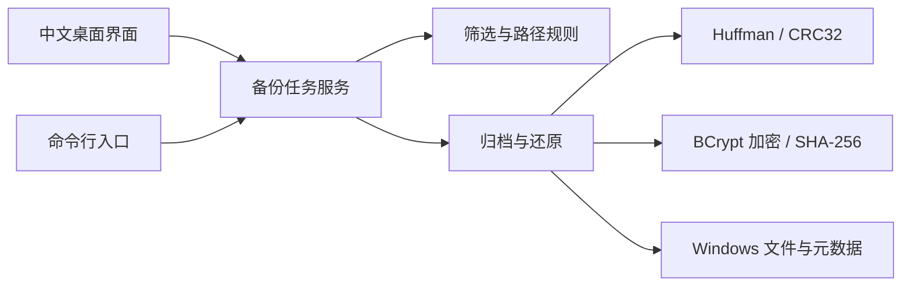
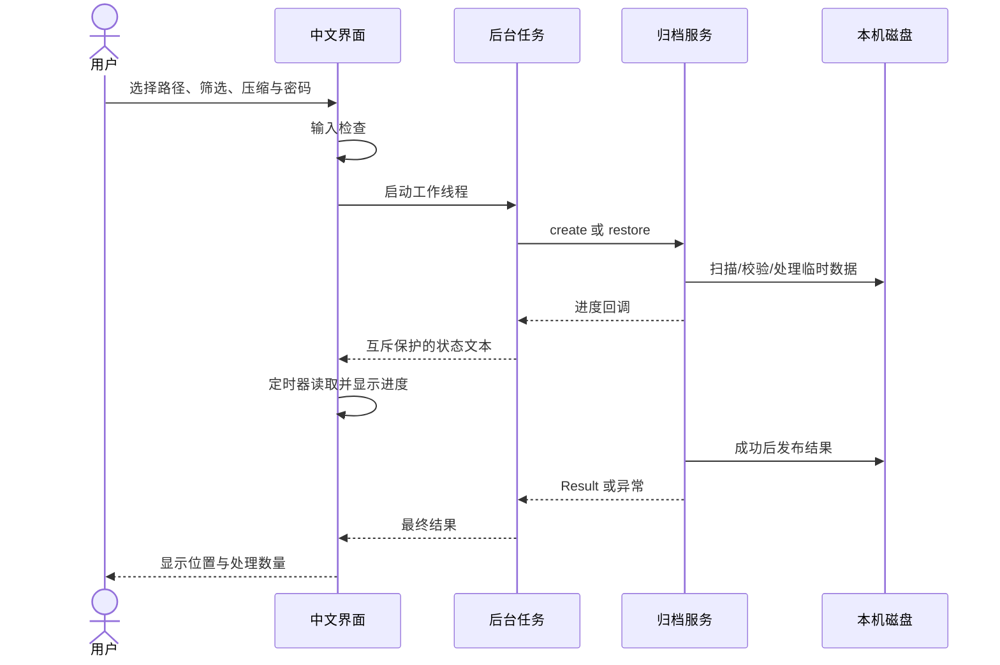
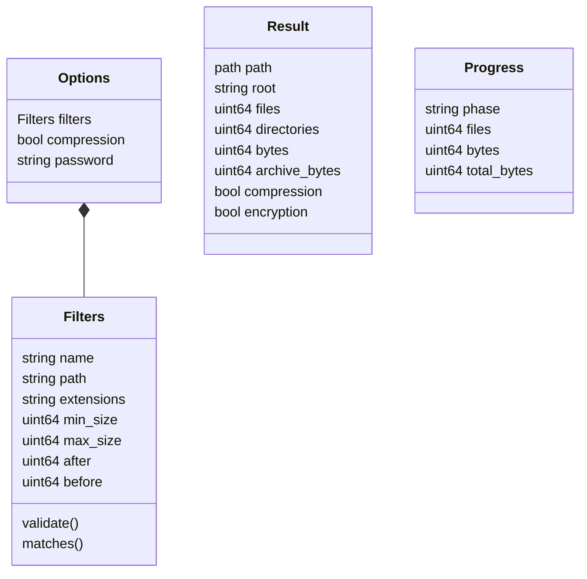

# 第一版设计与接口

## 模块职责

界面和命令行只负责收集输入、展示结果，备份行为均由共享核心完成。首版无服务器与数据库。

## 核心 C++ 接口

接口命名空间为 `backup`，声明位于 `src/backup.hpp`。

| 接口 | 输入 | 输出 |
|---|---|---|
| `create` | 源目录、输出文件、`Options`、可选进度回调 | `Result` |
| `restore` | 归档文件、已有目标目录、密码、可选进度回调 | `Result`，路径为生成的还原目录 |
| `inspect` | 归档文件、密码、可选进度回调 | `Result`，完整校验但不生成还原目录 |
| `compress/decompress` | 字节数组、解码时的预期原始长度 | 字节数组 |

`Options` 包含筛选、压缩开关和密码；`Filters` 包含文件名、相对路径、扩展名、大小与时间边界。核心大小单位为字节，核心时间为 FILETIME 整数；入口负责将日期文本转为本地日期边界。

`Result` 包含结果位置、原根目录名、文件数、含根目录的目录数、原始字节数、归档字节数、压缩与加密标志。`Progress` 包含阶段、已完成文件数、已处理字节和已知总字节。还原或检查总字节在结束前可能未知，取 0。

可预期的验证错误抛出 `backup::Error`；文件系统也可能抛出标准异常。两个入口均捕获异常并展示失败原因。CLI 返回非零退出码；GUI 在状态栏显示失败，输入校验错误使用提示框。

## 备份与还原交互

工作线程不会直接操作窗口。状态由互斥锁保护，主线程每 100ms 读取一次。任务运行时锁定输入、禁止重复提交；用户可切换说明页面；关闭时要求等待完成。任务结束后主线程回收线程并恢复输入。

## 数据类型关系

这些设计说明用于解释实际代码，不替代最终课程报告中的完整需求用例、UML 构件图和报告模板内容。
